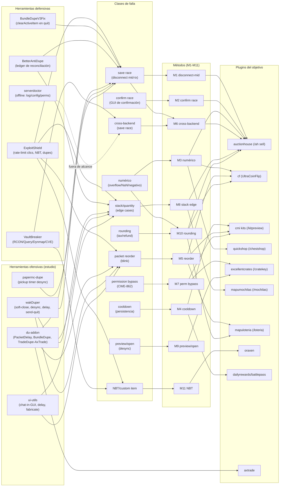

# Grafo de navegación — investigación de exploits

> `graphify` CLI no está disponible en este entorno; este grafo Mermaid cumple la misma función de navegación y puede abrirse en cualquier visor Mermaid (o en `research/GRAPH.html` si se renderiza).

## Leyenda

- `-->` relación documentada en una herramienta o derivada por causa raíz.
- `-.->` relación fuera del alcance black-box (requiere archivos).
- Para cada nodo de método existe un playbook en `skills/` y, cuando aplica, un snippet en `research/snippets/`.
